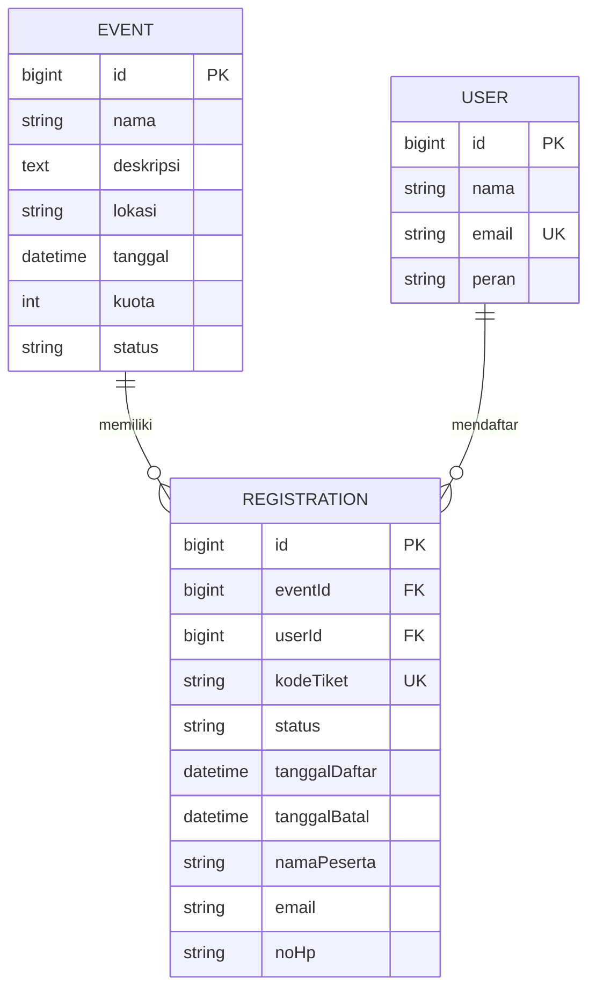

# Model Data & ERD — RPL Event

| Item | Keterangan |
|------|------------|
| Produk | RPL Event — Aplikasi Manajemen & Pendaftaran Acara |
| Versi | 1.0 |
| Tanggal | 14 November 2026 |
| Mengacu pada | `PRD.md`, `docs/srs.md`, `docs/uml/skenario-use-case.md` |
| Status | Final untuk v1.0 |

---

## 1. Tujuan

Dokumen ini merinci model data RPL Event: entitas, atribut, primary key, relasi, constraint, dan nilai turunan yang tidak disimpan. ERD ditulis dengan **Mermaid.js** agar dapat dirender langsung di GitHub atau editor Markdown yang mendukung Mermaid.

Dokumen ini melengkapi:

- `PRD.md` — kebutuhan produk.
- `docs/srs.md` §6–§7 — kamus data & aturan bisnis.
- `docs/uml/skenario-use-case.md` — alur UC-01…UC-15.

---

## 2. Prinsip Model

1. **Tiga entitas inti:** `Event`, `User`, dan `Registration`.
2. **Primary key otomatis:** setiap tabel memakai `id` auto (BIGINT auto-increment atau UUID).
3. **Natural key tetap unik:** `User.email` dan `Registration.kodeTiket` diberi constraint unik, tetapi bukan PK.
4. **Nilai turunan tidak disimpan:** `tiketTerjual`, `sisaKuota`, persentase keterisian, dan ringkasan dihitung saat query.
5. **Relasi M:N dipecah:** Event–User dihubungkan oleh `Registration` sebagai tabel penghubung yang punya atribut relasi.
6. **Data pribadi dilindungi:** `email` dan `noHp` tidak ditampilkan ke publik.

---

## 3. Entitas & Primary Key

| Entitas | Peran | Primary Key | Unik / Natural Key |
|---|---|---|---|
| `Event` | Acara yang dapat diikuti | `id` (auto) | — (`nama` tidak unik) |
| `User` | Identitas peserta/admin | `id` (auto) | `email` unik (case-insensitive) |
| `Registration` | Pendaftaran peserta pada acara | `id` (auto) | `kodeTiket` unik global; `(eventId, email)` unik untuk status aktif |

> **Pilihan tipe `id`:** `BIGINT AUTO_INCREMENT` untuk database relasional, atau `UUID` jika ingin tetap bertipe `string` seperti kode saat ini. Jangan memakai `email`, `nama`, atau `kodeTiket` sebagai PK.

---

## 4. Atribut Entitas

### 4.1 `Event`

| Atribut | Tipe | Wajib | Unik | Batas/validasi | Default | Sumber |
|---|---|---:|---:|---|---|---|
| `id` | `BIGINT` auto / `UUID` | Ya | Ya (PK) | Otomatis, tidak null | Auto | SRS §6.1 |
| `nama` | `VARCHAR(150)` | Ya | Tidak | 1–150 karakter; trim; tidak kosong | — | PRD §6/§8; SRS §6.1; UC-01/02/06 |
| `deskripsi` | `TEXT` | Ya | Tidak | 1–2.000 karakter | — | SRS §6.1; UC-02/06 |
| `lokasi` | `VARCHAR(255)` | Ya | Tidak | 1–255 karakter | — | SRS §6.1; UC-01/02/06 |
| `tanggal` | `TIMESTAMPTZ` | Ya | Tidak | Tanggal valid; acara baru sebaiknya `>= now()` | — | SRS §6.1; UC-01/02/06; BR-05/07 |
| `kuota` | `INTEGER` | Ya | Tidak | `> 0`; saat update `>=` jumlah pendaftar aktif | — | SRS §6.1; FR-10; UC-02/06/09; BR-01/03 |
| `status` | `ENUM` | Ya | Tidak | `upcoming` / `ongoing` / `done` | `upcoming` | SRS §6.1; BR-07 |

**Catatan:**

- `nama` tidak unik karena dua acara berbeda boleh memiliki nama sama.
- `tanggal` disimpan sebagai tanggal + waktu (`TIMESTAMPTZ`) agar UC-05 dapat menentukan “acara belum berlangsung”.
- `kuota >= jumlah pendaftar aktif` menjamin `sisaKuota >= 0`; `sisaKuota` sendiri tidak disimpan.
- `status` adalah state bisnis. Jika ingin sepenuhnya dihitung, tambahkan `tanggalSelesai` lalu turunkan status saat query.

### 4.2 `User`

| Atribut | Tipe | Wajib | Unik | Batas/validasi | Default | Sumber |
|---|---|---:|---:|---|---|---|
| `id` | `BIGINT` auto / `UUID` | Ya | Ya (PK) | Otomatis, tidak null | Auto | SRS §6.2 |
| `nama` | `VARCHAR(100)` | Ya | Tidak | 1–100 karakter | — | SRS §6.2; UC-03 |
| `email` | `VARCHAR(254)` | Ya | Ya (case-insensitive) | Format email valid; trim + lowercase; maks. 254 karakter | — | SRS §6.2; UC-03; FR-04/06; BR-02 |
| `peran` | `ENUM` | Ya | Tidak | `peserta` / `admin` | `peserta` | SRS §6.2 |

**Catatan:**

- `email` unik global: satu email = satu identitas.
- Tanpa autentikasi, `User` dibuat/dicari berdasarkan email saat pendaftaran.
- Tidak ada `password` di v1 karena autentikasi masih **Won't**.
- Nomor HP berada di `Registration`, bukan `User`.

### 4.3 `Registration`

| Atribut | Tipe | Wajib | Unik | Batas/validasi | Default | Sumber |
|---|---|---:|---:|---|---|---|
| `id` | `BIGINT` auto / `UUID` | Ya | Ya (PK) | Otomatis, tidak null | Auto | SRS §6.3 |
| `eventId` | `BIGINT` / `UUID` | Ya | Tidak | FK → `Event.id`; `ON DELETE RESTRICT` atau soft delete | — | SRS §6.3; UC-03 |
| `userId` | `BIGINT` / `UUID` | Ya | Tidak | FK → `User.id` | — | SRS §6.3; UC-03/04 |
| `namaPeserta` | `VARCHAR(100)` | Ya | Tidak | 1–100 karakter; snapshot saat mendaftar | — | SRS §6.3; UC-03/10 |
| `email` | `VARCHAR(254)` | Ya | Ya per acara untuk status aktif | Format email; lowercase + trim | — | SRS §6.3; UC-03/10; BR-02 |
| `noHp` | `VARCHAR(20)` | Ya | Tidak | 8–20 karakter; digit, `+`, `-`, spasi; dinormalisasi | — | SRS §6.3; UC-03/10 |
| `kodeTiket` | `VARCHAR(20)` | Ya | Ya (global) | Dibuat sistem; unik; mis. `RPL-XXXXXX` | Generate | SRS §6.3; FR-07; UC-14; BR-04 |
| `status` | `ENUM` | Ya | Tidak | `aktif` / `dibatalkan` | `aktif` | SRS §6.3; UC-05; BR-06 |
| `tanggalDaftar` | `TIMESTAMPTZ` | Ya | Tidak | `<= now()` | `now()` | SRS §6.3; UC-03 |
| `tanggalBatal` | `TIMESTAMPTZ` | Tidak | Tidak | `>= tanggalDaftar`; hanya diisi jika status `dibatalkan` | `NULL` | UC-05 (opsional/audit) |

**Catatan:**

- `email` tidak unik global; yang unik adalah `(eventId, email)` untuk pendaftaran aktif.
- `noHp` tidak unik karena satu nomor dapat dipakai beberapa peserta.
- `kodeTiket` di-generate tetapi wajib disimpan karena hasilnya acak dan tidak dapat dihitung ulang.
- `namaPeserta`, `email`, dan `noHp` adalah snapshot saat mendaftar.
- `tanggalBatal` opsional; dapat dihilangkan jika audit pembatalan tidak dibutuhkan.

---

## 5. Relasi

### 5.1 Ringkasan kardinalitas

| Pasangan | Kardinalitas | Arah pertama | Arah kedua | Implementasi |
|---|---|---|---|---|
| `Event`–`Registration` | 1 : 0..N | Satu Event memiliki nol atau banyak Registration. | Satu Registration dimiliki oleh tepat satu Event. | FK `eventId` di `Registration` |
| `User`–`Registration` | 1 : 0..N | Satu User memiliki nol atau banyak Registration. | Satu Registration dimiliki oleh tepat satu User. | FK `userId` di `Registration` |
| `Event`–`User` | 0..N : 0..N | Satu Event diikuti oleh nol atau banyak User melalui Registration. | Satu User dapat mengikuti nol atau banyak Event melalui Registration. | Tabel penghubung `Registration` |

### 5.2 Relasi dua arah

**Event–Registration**

> Satu Event memiliki nol atau banyak Registration.
> Satu Registration dimiliki oleh tepat satu Event.

**User–Registration**

> Satu User memiliki nol atau banyak Registration.
> Satu Registration dimiliki oleh tepat satu User.

**Event–User**

> Satu Event diikuti oleh nol atau banyak User melalui Registration.
> Satu User dapat mengikuti nol atau banyak Event melalui Registration.

### 5.3 Tabel penghubung M:N

Relasi Event–User adalah **M:N**. Tabel penghubungnya adalah `Registration`; tidak perlu tabel `EventUser` terpisah.

`Registration` menyimpan atribut relasi yang hanya bermakna untuk pasangan Event–User tertentu:

| Atribut | Peran | Alasan berada di `Registration` |
|---|---|---|
| `id` | PK | Identitas unik pendaftaran. |
| `eventId` | FK → `Event` | Acara yang diikuti. |
| `userId` | FK → `User` | Peserta yang mendaftar. |
| `kodeTiket` | Atribut relasi | Hanya bermakna untuk pasangan Event–User tertentu. |
| `status` | Atribut relasi | Status aktif/dibatalkan berlaku per pendaftaran. |
| `tanggalDaftar` | Atribut relasi | Waktu pasangan Event–User tercipta. |
| `tanggalBatal` | Atribut relasi opsional | Waktu pembatalan. |
| `namaPeserta` | Snapshot | Nama saat mendaftar pada acara tersebut. |
| `email` | Snapshot | Email saat mendaftar. |
| `noHp` | Snapshot | Nomor HP saat mendaftar. |

**Atribut yang tetap di entitas asal:**

| Atribut | Tetap di | Alasan |
|---|---|---|
| `nama`, `deskripsi`, `lokasi`, `tanggal`, `kuota`, `status` | `Event` | Milik acara, berlaku untuk semua pendaftaran. |
| `nama`, `email`, `peran` | `User` | Milik identitas pengguna, berlaku lintas acara. |

> Untuk satu pasangan Event–User, jumlah Registration **aktif** maksimal satu (BR-02). Jika pendaftaran ulang setelah pembatalan diizinkan, baris historis bisa lebih dari satu.

---

## 6. Nilai Turunan yang Tidak Disimpan

| Nilai | Dihitung dari | Alasan tidak disimpan |
|---|---|---|
| `tiketTerjual` | `COUNT(Registration WHERE eventId = ? AND status = 'aktif')` | Agregat; berubah saat daftar/batal. |
| `sisaKuota` | `Event.kuota - tiketTerjual` | Turunan langsung. |
| `jumlahPesertaAktif` | `COUNT(Registration ...)` | Sama dengan `tiketTerjual`. |
| `persentaseKeterisian` | `tiketTerjual / Event.kuota * 100` | Turunan. |
| `daftarPeserta` | Query join `Registration` + `User` + `Event` | Hasil query, bukan tabel baru. |
| `ringkasanAcara` | Agregat `COUNT`, persentase | Dihitung saat ditampilkan. |
| `fileCsv` | Generate dari query | Transien. |

> UC-03 dan UC-05 menyebut “mengurangi/memperbarui sisa kuota” sebagai perilaku bisnis. Dalam model ini tidak ada kolom `sisaKuota`; nilainya dihitung ulang dari `Registration` setiap kali ditampilkan.

> Prinsip yang sama berlaku jika nanti ada harga tiket: jangan simpan `subtotal` atau `totalBayar`; hitung dari `jumlah × hargaSatuan`.

---

## 7. Constraint & Aturan Bisnis

- **PK auto:** `Event.id`, `User.id`, `Registration.id`.
- **FK:** `Registration.eventId → Event.id`, `Registration.userId → User.id`.
- **`Event.kuota > 0`.**
- **`Event.kuota >= jumlah pendaftar aktif`** — dicek di aplikasi/transaksi saat update kuota.
- **`User.email` unik case-insensitive.**
- **`Registration.kodeTiket` unik global.**
- **`Registration (eventId, email)` unik untuk status `aktif`** — partial unique index.
- **Pembatalan hanya jika acara belum berlangsung** (BR-05).
- **Pembatalan** mengubah `status` menjadi `dibatalkan`; kuota kembali otomatis karena `sisaKuota` dihitung.
- **Hapus Event** yang memiliki Registration: restrict atau soft delete; jangan cascade.
- **Email** dinormalisasi (`trim` + lowercase) sebelum disimpan/dicek.
- **Kode tiket** dibuat dengan pengecekan collision dan retry.

Contoh partial unique index (PostgreSQL):

```sql
CREATE UNIQUE INDEX uq_registration_active_email
ON registration (event_id, lower(email))
WHERE status = 'aktif';
```

Jika memakai MySQL yang tidak mendukung partial index, gunakan generated column atau validasi di aplikasi/transaksi.

---

## 8. ERD (Mermaid.js)



> Blok di atas telah dirender dengan `@mermaid-js/mermaid-cli` v12.2.0 tanpa error.

**Cara membaca:**

- `||--o{` berarti **satu ke nol atau banyak**.
- `Registration` adalah tabel penghubung yang menyelesaikan relasi M:N Event–User.
- Relasi konseptual M:N tidak digambar sebagai garis langsung agar atribut relasi tetap terlihat di `Registration`.

---

## 9. Catatan Implementasi

1. **Tipe `id`:** pilih `BIGINT AUTO_INCREMENT` atau `UUID`; jangan campur. ERD mencontohkan `bigint`; jika memilih UUID, ganti tipe `id` dan FK menjadi `string`.
2. **Penamaan:** dokumen ini memakai istilah bisnis SRS (`nama`, `deskripsi`, `tanggal`, `kuota`, `kodeTiket`); kode TypeScript saat ini memakai padanan Inggris (`name`, `description`, `date`, `quota`, `ticketCode`). Petakan secara konsisten.
3. **Enum:** SRS memakai `peserta`/`aktif`/`dibatalkan`, kode memakai `participant`/`active`/`cancelled`. Pilih satu konvensi; rekomendasi: simpan nilai Inggris di database, tampilkan label Indonesia di UI.
4. **Zona waktu:** simpan `TIMESTAMPTZ` atau ISO 8601 dengan offset, tampilkan `Asia/Jakarta`.
5. **Mock data:** `ticketsSold` di `src/data/events.ts` boleh dianggap seed/cache untuk prototipe; di database jangan jadikan kolom sumber kebenaran.
6. **PII:** `email` dan `noHp` hanya untuk admin/panitia; jangan tampilkan di halaman publik.
7. **Masa depan:** jika ada beberapa jenis tiket, tambahkan `TicketType` dan `RegistrationItem`; `jumlah` dan `hargaSatuan` diletakkan di `RegistrationItem`, sedangkan `subtotal`/`total` tidak disimpan.

---

## 10. Riwayat Versi

| Versi | Tanggal | Perubahan | Penulis |
|---|---|---|---|
| 1.0 | 14-11-2026 | Model data, relasi, constraint, dan ERD Mermaid | Tim RPL Event |
