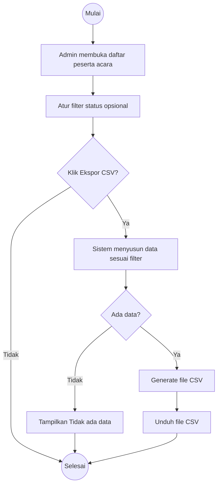

# Activity Diagram — Ekspor Data Peserta

Alur aktivitas **admin/panitia mengekspor daftar peserta** ke CSV.

## Kebutuhan Terkait

- **FR:** FR-12
- **User Story:** US-11
- **Use Case:** UC-11

## Hasil Render (Verifikasi Visual)

