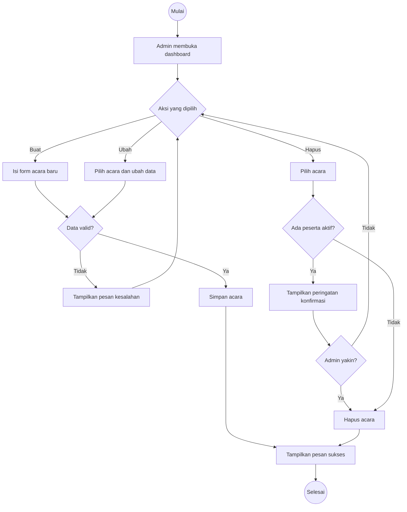

# Activity Diagram — Kelola Acara (Admin)

Alur aktivitas **admin mengelola acara**: membuat, mengubah, dan menghapus.

## Kebutuhan Terkait

- **FR:** FR-01, FR-10
- **User Story:** US-07, US-08, US-09
- **Use Case:** UC-06, UC-07, UC-08
