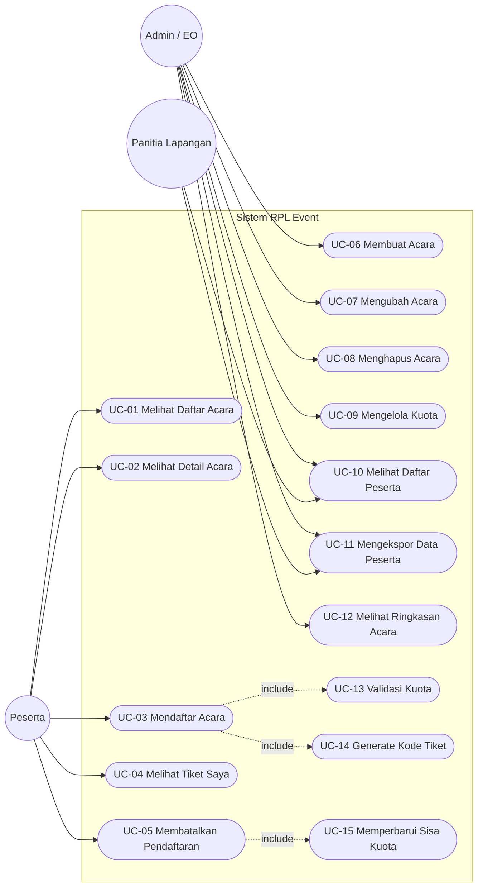

# Use Case Diagram — RPL Event

Diagram *use case* menggambarkan interaksi antara **aktor** dan **fungsi sistem** pada aplikasi RPL Event.

## Aktor

| Aktor | Deskripsi |
|-------|-----------|
| **Peserta** | Pengguna yang melihat dan mendaftar acara. |
| **Admin / EO** | Pengguna yang mengelola acara, kuota, dan peserta. |
| **Panitia Lapangan** | Pengguna yang memanfaatkan data peserta untuk *check-in*. |

## Diagram Use Case

## Keterangan Relasi

| Relasi | Arti |
|--------|------|
| `-->` | Asosiasi aktor dengan *use case*. |
| `-.->|include|` | *Use case* yang **wajib** dijalankan sebagai bagian dari *use case* utama. |

- **UC-03 Mendaftar Acara** selalu menyertakan **UC-13 Validasi Kuota** dan **UC-14 Generate Kode Tiket**.
- **UC-05 Membatalkan Pendaftaran** menyertakan **UC-15 Memperbarui Sisa Kuota**.

## Catatan Notasi

Mermaid **tidak menyediakan notasi diagram *use case* UML secara native**. Diagram di atas direpresentasikan dengan `flowchart`:

- **Aktor** digambarkan sebagai node lingkaran `(( ))`.
- ***Use case*** digambarkan sebagai node *stadium* `([ ])`.
- **Batas sistem** digambarkan dengan `subgraph`.

## Keterkaitan

- Konsisten dengan `docs/srs.md` (FR-01…FR-13) dan `docs/elisitasi/user-story.md` (US-01…US-13).
- Skenario rinci tiap *use case*: `docs/uml/skenario-use-case.md`.
- Model data, relasi, dan ERD: `docs/data-model.md`.
- Verifikasi diagram: `docs/uml/verifikasi-diagram.md`.

## Hasil Render (Verifikasi Visual)

