# Verifikasi Diagram UML — RPL Event

Dokumen ini mencatat **hasil verifikasi** seluruh diagram pada folder `docs/uml/`.

## 1. Tujuan & Metode

- **Tujuan:** Memastikan diagram Mermaid valid secara sintaks dan konsisten dengan kebutuhan (`docs/srs.md`) serta *user story* (`docs/elisitasi/user-story.md`).
- **Metode:**
  1. **Pemeriksaan sintaks** — meninjau struktur blok `mermaid`, pasangan kurung, dan sintaks relasi.
  2. **Pemeriksaan kelengkapan** — memastikan setiap diagram punya awal/akhir, keputusan bercabang, dan aktor terhubung.
  3. **Pemeriksaan konsistensi** — mencocokkan aktor/use case/aktivitas dengan FR dan US.
  4. **Render otomatis** — mengekstrak tiap blok Mermaid lalu merendernya ke SVG dengan `@mermaid-js/mermaid-cli` (`mmdc`) v11.17.1.

> **Catatan:** Verifikasi dilakukan **statis + render otomatis**. Hasil render disimpan di `docs/uml/rendered/` dan ditampilkan pada tiap dokumen diagram.

## 2. Lingkup Diagram yang Diverifikasi

| No | File | Jenis | Jumlah Diagram |
|----|------|-------|----------------|
| 1 | `use-case.md` | Use Case (flowchart) | 1 |
| 2 | `activity-pendaftaran-acara.md` | Activity (flowchart) | 1 |
| 3 | `activity-pembatalan-pendaftaran.md` | Activity (flowchart) | 1 |
| 4 | `activity-kelola-acara.md` | Activity (flowchart) | 1 |
| 5 | `activity-ekspor-peserta.md` | Activity (flowchart) | 1 |
| 6 | `skenario-use-case.md` | Skenario tekstual | — |

**Total diagram Mermaid:** 5.

## 3. Checklist Sintaks Mermaid

| No | Butir Pemeriksaan | Status |
|----|-------------------|--------|
| 1 | Setiap blok memakai `flowchart` dengan arah valid (`LR`/`TD`) | ✅ |
| 2 | Node ID unik dalam satu diagram | ✅ |
| 3 | Pasangan kurung seimbang (`(( ))`, `[ ]`, `([ ])`, `{ }`) | ✅ |
| 4 | Label relasi memakai sintaks `-->|teks|` atau `-.->|teks|` | ✅ |
| 5 | `subgraph` memiliki penutup `end` | ✅ |
| 6 | Tidak ada karakter yang merusak sintaks tanpa *escape* | ✅ (diperbaiki) |

> Pada render pertama ditemukan *parse error* akibat tanda kutip ganda (`"`) di dalam label node. Tanda kutip dihapus sehingga seluruh diagram berhasil dirender.

## 4. Verifikasi per Diagram

### 4.1 `use-case.md`

| Aspek | Hasil |
|-------|-------|
| Aktor terdefinisi | ✅ Peserta, Admin/EO, Panitia Lapangan |
| Use case terhubung ke aktor/include | ✅ Semua UC punya relasi |
| Relasi `include` valid | ✅ UC-13 & UC-14 (dari UC-03), UC-15 (dari UC-05) |
| Batas sistem (`subgraph`) | ✅ Ada |
| Tidak ada node yatim | ✅ |

### 4.2 `activity-pendaftaran-acara.md`

| Aspek | Hasil |
|-------|-------|
| Titik awal & akhir | ✅ `S` dan `Z` |
| Keputusan punya ≥ 2 cabang | ✅ (valid?, kuota?, email?) |
| Alur alternatif (kuota penuh, duplikat, invalid) | ✅ |
| Konsisten dengan FR-04…FR-07 | ✅ |

### 4.3 `activity-pembatalan-pendaftaran.md`

| Aspek | Hasil |
|-------|-------|
| Titik awal & akhir | ✅ |
| Keputusan punya ≥ 2 cabang | ✅ (acara lewat?, yakin?) |
| Update kuota setelah batal | ✅ |
| Konsisten dengan FR-08 | ✅ |

### 4.4 `activity-kelola-acara.md`

| Aspek | Hasil |
|-------|-------|
| Titik awal & akhir | ✅ |
| Tiga aksi (buat/ubah/hapus) tercakup | ✅ |
| Validasi & konfirmasi hapus | ✅ |
| Konsisten dengan FR-01, FR-10 | ✅ |

### 4.5 `activity-ekspor-peserta.md`

| Aspek | Hasil |
|-------|-------|
| Titik awal & akhir | ✅ |
| Keputusan punya ≥ 2 cabang | ✅ (klik ekspor?, ada data?) |
| Konsisten dengan FR-12 | ✅ |

## 5. Konsistensi dengan SRS & User Story

| UC | Nama | FR | User Story | Diagram Aktivitas |
|----|------|----|-----------|-------------------|
| UC-01 | Melihat Daftar Acara | FR-02 | US-01 | — |
| UC-02 | Melihat Detail Acara | FR-03 | US-02 | — |
| UC-03 | Mendaftar Acara | FR-04, FR-05, FR-06, FR-07 | US-03, US-04 | `activity-pendaftaran-acara.md` |
| UC-04 | Melihat Tiket Saya | FR-09 | US-06 | — |
| UC-05 | Membatalkan Pendaftaran | FR-08 | US-05 | `activity-pembatalan-pendaftaran.md` |
| UC-06 | Membuat Acara | FR-01 | US-07 | `activity-kelola-acara.md` |
| UC-07 | Mengubah Acara | FR-01 | US-08 | `activity-kelola-acara.md` |
| UC-08 | Menghapus Acara | FR-01 | US-08 | `activity-kelola-acara.md` |
| UC-09 | Mengelola Kuota | FR-10 | US-09 | `activity-kelola-acara.md` |
| UC-10 | Melihat Daftar Peserta | FR-11 | US-10 | — |
| UC-11 | Mengekspor Data Peserta | FR-12 | US-11 | `activity-ekspor-peserta.md` |
| UC-12 | Melihat Ringkasan Acara | FR-13 | US-12 | — |
| UC-13 | Validasi Kuota | FR-05 | US-03 | `activity-pendaftaran-acara.md` |
| UC-14 | Generate Kode Tiket | FR-07 | US-04 | `activity-pendaftaran-acara.md` |
| UC-15 | Memperbarui Sisa Kuota | FR-08 | US-05 | `activity-pembatalan-pendaftaran.md` |

## 6. Temuan & Tindakan

| No | Temuan | Tindakan |
|----|--------|----------|
| 1 | Mermaid tidak punya notasi *use case* UML native | Menggunakan `flowchart` dengan aktor (lingkaran), use case (*stadium*), dan batas sistem (`subgraph`); didokumentasikan di `use-case.md`. |
| 2 | Alur pembatalan perlu eksplisit memperbarui kuota | Menambahkan **UC-15 Memperbarui Sisa Kuota** sebagai `include` dari UC-05. |
| 3 | Pendaftaran punya sub-alur validasi & tiket | Menambahkan **UC-13** & **UC-14** sebagai `include` dari UC-03. |
| 4 | Beberapa use case belum punya diagram aktivitas | Hanya alur utama/kritis yang dibuat activity diagram; sisanya diwakili skenario tekstual. |
| 5 | Render menemukan *parse error* akibat tanda kutip ganda pada label node | Menghapus `"` pada label di `activity-ekspor-peserta.md`, `activity-pembatalan-pendaftaran.md`, dan `activity-pendaftaran-acara.md`; render ulang berhasil. |

## 7. Hasil Render Otomatis

Diuji dengan `@mermaid-js/mermaid-cli` (`mmdc`) **v11.17.1**.

| No | Diagram | File Hasil | Ukuran | Status |
|----|---------|-----------|--------|--------|
| 1 | Use Case | `rendered/use-case.svg` | 676.762 B | ✅ Berhasil |
| 2 | Activity — Pendaftaran Acara | `rendered/activity-pendaftaran-acara.svg` | 34.931 B | ✅ Berhasil |
| 3 | Activity — Pembatalan Pendaftaran | `rendered/activity-pembatalan-pendaftaran.svg` | 27.443 B | ✅ Berhasil |
| 4 | Activity — Kelola Acara | `rendered/activity-kelola-acara.svg` | 37.532 B | ✅ Berhasil |
| 5 | Activity — Ekspor Data Peserta | `rendered/activity-ekspor-peserta.svg` | 26.055 B | ✅ Berhasil |

**Ringkasan:** **5/5** diagram berhasil dirender tanpa error setelah perbaikan sintaks.

### Galeri Hasil Render

#### Use Case

#### Activity — Pendaftaran Acara

#### Activity — Pembatalan Pendaftaran

#### Activity — Kelola Acara

#### Activity — Ekspor Data Peserta

## 8. Keterbatasan

- Notasi *use case* & *activity* pada Mermaid memakai `flowchart` (pendekatan), bukan notasi UML formal.
- Beberapa elemen UML formal (mis. *extend*, *generalization*) tidak digunakan.
- Ukuran SVG *use case* relatif besar (≈677 KB) karena gaya bawaan Mermaid.

## 9. Kesimpulan

Seluruh **5 diagram Mermaid** berhasil **dirender otomatis tanpa error** (setelah memperbaiki tanda kutip pada label node) dan konsisten dengan `docs/srs.md` serta `docs/elisitasi/user-story.md`. Hasil render tersedia di `docs/uml/rendered/`. Diagram dinyatakan **valid dan siap dipakai** untuk laporan.

## 10. Riwayat Versi

| Versi | Tanggal | Perubahan | Penulis |
|-------|---------|-----------|---------|
| 1.0 | 11-11-2026 | Verifikasi awal diagram UML | Tim RPL Event |
| 1.1 | 11-11-2026 | Render otomatis & perbaikan sintaks label | Tim RPL Event |
